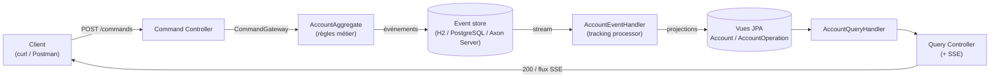

# Bank Account — CQRS & Event Sourcing avec Axon Framework

Application de **gestion de comptes bancaires** illustrant les patterns **CQRS** et **Event Sourcing** avec
**Axon Framework**, **Spring Boot** et **Axon Server** — un seul artefact, trois modes de déploiement.


---

## Sommaire

- [Aperçu](#aperçu)
- [Architecture](#architecture)
- [Stack technique](#stack-technique)
- [Démarrage rapide](#démarrage-rapide)
- [API HTTP](#api-http)
- [Modèle métier](#modèle-métier)
- [Tests](#tests)
- [Infrastructure Docker](#infrastructure-docker)
- [Exploitation des projections](#exploitation-des-projections)
- [Structure du projet](#structure-du-projet)
- [Collection Postman](#collection-postman)

---

## Aperçu

- **Event Sourcing** : l'état d'un compte n'est jamais stocké directement — il est reconstruit par rejeu des
  événements persistés dans l'event store (append-only, source de vérité).
- **CQRS** : le côté commande (écriture) et le côté requête (lecture) sont physiquement séparés — packages,
  contrôleurs et bus distincts.
- **Fonction de décision** `(état, commande) → événements` : toutes les règles métier vivent dans l'agrégat
  (`@CommandHandler`) ; la fonction d'évolution `(état, événement) → état` les applique sans validation
  (`@EventSourcingHandler`).
- **Projections JPA** alimentées par un **tracking processor** (`account-projection`), requêtes via le
  `QueryGateway`, et **suivi temps réel en Server-Sent Events** (subscription query).
- **Montants en `BigDecimal`** exclusivement — jamais `double`/`float`.

## Architecture



| Profil | Event store | Projections | Bus |
|---|---|---|---|
| `local` (défaut) | H2 mémoire | H2 mémoire | connecteurs Axon locaux |
| `postgres` | PostgreSQL | PostgreSQL | connecteurs Axon locaux |
| `axonserver` | Axon Server (gRPC) | PostgreSQL | Axon Server |

La bascule se fait **par profil Spring** (`axon.axonserver.enabled`), sans modifier le `pom.xml` ni le code.

## Stack technique

| Composant | Version | Rôle |
|---|---|---|
| Java | 21 (LTS) | runtime |
| Spring Boot | 3.4.3 | Web MVC, Data JPA, Validation, Actuator |
| Axon Framework | 4.10.3 | bus, agrégat event-sourced, tracking processor, subscription queries |
| Axon Server | 4.6.10 | event store + bus gRPC (mode `axonserver`) |
| PostgreSQL | 16-alpine | event store JDBC + projections |
| H2 | (Boot) | modes `local` et `test` (mémoire) |
| springdoc-openapi | 2.8.13 | Swagger UI |

## Démarrage rapide

**Prérequis** : JDK 21, Docker Desktop (modes `postgres` / `axonserver`). Le wrapper Maven est fourni.

```bash
git clone https://github.com/saadaitsaid26/bank-account-cqrs-axon.git
cd bank-account-cqrs-axon
```

### Build et tests

```powershell
.\mvnw.cmd clean verify
```

> Maven doit tourner sur un **JDK 21**. Si le `java` système est plus ancien, définir `JAVA_HOME` avant la commande.

### Mode local (défaut — H2 mémoire, aucun Docker)

```powershell
.\mvnw.cmd spring-boot:run
```

### Mode PostgreSQL

```powershell
docker compose up -d postgres pgadmin
.\mvnw.cmd spring-boot:run "-Dspring-boot.run.profiles=postgres"
```

### Mode Axon Server

```powershell
docker compose up -d
.\mvnw.cmd spring-boot:run "-Dspring-boot.run.profiles=axonserver"
```

### Scripts d'orchestration (PowerShell)

```powershell
.\scripts\start.ps1 -Mode local        # ou postgres / axonserver
.\scripts\stop.ps1                     # arrête l'infrastructure Docker
.\scripts\verify.ps1                   # build + tests + validation compose
```

L'application écoute sur **http://localhost:8066**. Interfaces utiles :

| Service | URL |
|---|---|
| Swagger UI | http://localhost:8066/swagger-ui.html |
| Health | http://localhost:8066/actuator/health |
| pgAdmin | http://localhost:8088 (`admin@tp4-cqrs.com` / `admin`) |
| Axon Server | http://localhost:8024 |

## API HTTP

### Commandes (écriture)

| Méthode | Chemin | Description |
|---|---|---|
| `POST` | `/commands/accounts` | Créer un compte — `201 Created`, corps = identifiant |
| `POST` | `/commands/accounts/{id}/credit` | Créditer (`amount`, `currency`) |
| `POST` | `/commands/accounts/{id}/debit` | Débiter (`amount`, `currency`) |
| `POST` | `/commands/accounts/{id}/activate` | Activer |
| `POST` | `/commands/accounts/{id}/suspend` | Suspendre |
| `POST` | `/commands/accounts/{id}/block` | Bloquer |
| `GET` | `/commands/events/{id}` | Événements de l'agrégat lus dans l'event store |
| `GET` | `/commands/health-check` | Sonde du côté commande |

### Requêtes (lecture)

| Méthode | Chemin | Description |
|---|---|---|
| `GET` | `/query/accounts` | Liste des comptes (projection) |
| `GET` | `/query/accounts/{id}` | Compte par identifiant |
| `GET` | `/query/accounts/{id}/statement` | Relevé : compte + opérations |
| `GET` | `/query/accounts/{id}/watch` | **Flux SSE** : dernière opération, puis chaque nouvelle opération |
| `GET` | `/query/replayEvents` | Rejeu des projections |
| `GET` | `/query/resetTokens` | Réinitialise les tokens de suivi (changement de backend d'event store) |

### Exemple

```bash
# Création (201) — l'identifiant est renvoyé dans le corps et l'en-tête Location
curl -X POST http://localhost:8066/commands/accounts \
  -H "Content-Type: application/json" \
  -d '{"initialBalance": 500.00, "currency": "MAD"}'

# Crédit (200)
curl -X POST http://localhost:8066/commands/accounts/<id>/credit \
  -H "Content-Type: application/json" \
  -d '{"amount": 250.50, "currency": "MAD"}'

# Relevé (200)
curl http://localhost:8066/query/accounts/<id>/statement
```

### Codes d'erreur

| Code | Situation |
|---|---|
| `400` | Requête invalide : Bean Validation, JSON mal formé, règle simple refusée |
| `404` | Compte inconnu (y compris via le bus distant Axon Server) |
| `409` | Solde insuffisant |
| `500` | Erreur inattendue (sans stack trace dans la réponse) |

## Modèle métier

- **Commandes** : `CreateAccount`, `CreditAccount`, `DebitAccount`, `ActivateAccount`, `SuspendAccount`, `BlockAccount`.
- **Événements** : `AccountCreated`, `AccountActivated`, `AccountCredited`, `AccountDebited`, `AccountSuspended`, `AccountBlocked`.
- **Règles (dans l'agrégat uniquement)** :
  - solde initial ≥ 0 ; la création émet **deux événements** `Created` + `Activated` (démonstration du cours) ;
  - crédit/débit : montant > 0, compte `ACTIVATED`, devise identique à celle du compte ;
  - débit : solde suffisant, sinon `409`.

## Tests

`.\mvnw.cmd clean verify` → **36 tests, BUILD SUCCESS** (aucun test ne dépend de Docker).

| Niveau | Tests | Couverture |
|---|---|---|
| Agrégat (`AggregateTestFixture`) | 18 | toutes les règles métier, cas acceptés et refusés |
| Projections (Mockito) | 5 | chaque `@EventHandler`, émission SSE filtrée, `@ResetHandler` |
| Assemblage SSE (`StepVerifier`) | 2 | résultat initial + flux de mises à jour |
| Intégration HTTP (`MockMvc`) | 11 | cycle complet, erreurs 400/404/409, SSE, replay, resetTokens |

## Infrastructure Docker

`docker compose up -d` démarre (images épinglées) :

| Conteneur | Image | Ports |
|---|---|---|
| `tp4-postgres` | `postgres:16-alpine` | 5432 |
| `tp4-pgadmin` | `dpage/pgadmin4:8.12` | 8088 → 80 |
| `tp4-axonserver` | `axoniq/axonserver:4.6.10` | 8024 (UI/REST), 8124 (gRPC) |

Toutes les valeurs sont paramétrables via un fichier `.env` (modèle fourni : `.env.example`). Les healthchecks
sont natifs ; l'image Axon Server n'embarquant ni shell ni `curl`, un mini-client HTTP Java
(`docker/axonserver-healthcheck/AxonServerHealthCheck.java`) est compilé sur l'hôte et monté dans le conteneur.

**Application conteneurisée** (optionnelle) :

```powershell
.\mvnw.cmd clean package
docker compose --profile full up -d --build
```

## Exploitation des projections

- **`GET /query/replayEvents`** : rejoue tous les événements du store courant dans les projections.
- **`GET /query/resetTokens`** : remède au changement de backend d'event store (`postgres` ↔ `axonserver`).
  Les tokens de suivi persistés ont un type dépendant du backend ; l'endpoint purge les vues, supprime les
  tokens via l'API publique `TokenStore` (`fetchToken` puis `deleteToken`, jamais de SQL direct) et redémarre
  le processor depuis le début du store courant.

## Structure du projet

```text
src/main/java/ma/enset/tp4cqrs
├── commands
│   ├── aggregates      AccountAggregate (règles métier, double événement à la création)
│   ├── commands        6 commandes
│   ├── controllers     AccountCommandController
│   └── dto             DTOs de requête (Bean Validation)
├── events              6 événements immuables
├── queries
│   ├── controllers     AccountQueryController (+ flux SSE)
│   ├── dto             AccountStatementDTO
│   ├── entities        Account, AccountOperation (vues JPA)
│   ├── handlers        AccountEventHandler (projections), AccountQueryHandler
│   ├── queries         4 query messages
│   ├── repositories    Spring Data JPA
│   └── services        ReplayEventsService, TokenStoreCleaner
└── common
    ├── enums           AccountStatus, OperationType
    ├── exceptions      exceptions métier
    └── web             GlobalExceptionHandler (400/404/409/500)
```

## Collection Postman

Importer `postman/tp4-collection.json` : la requête *Create account* mémorise automatiquement l'identifiant
créé pour les requêtes suivantes (crédit, relevé, suivi SSE…).

---

Projet réalisé dans un cadre pédagogique (TP4 — architectures orientées événements & microservices).
